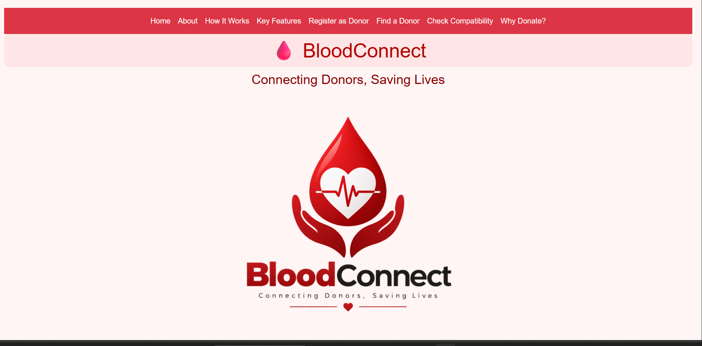
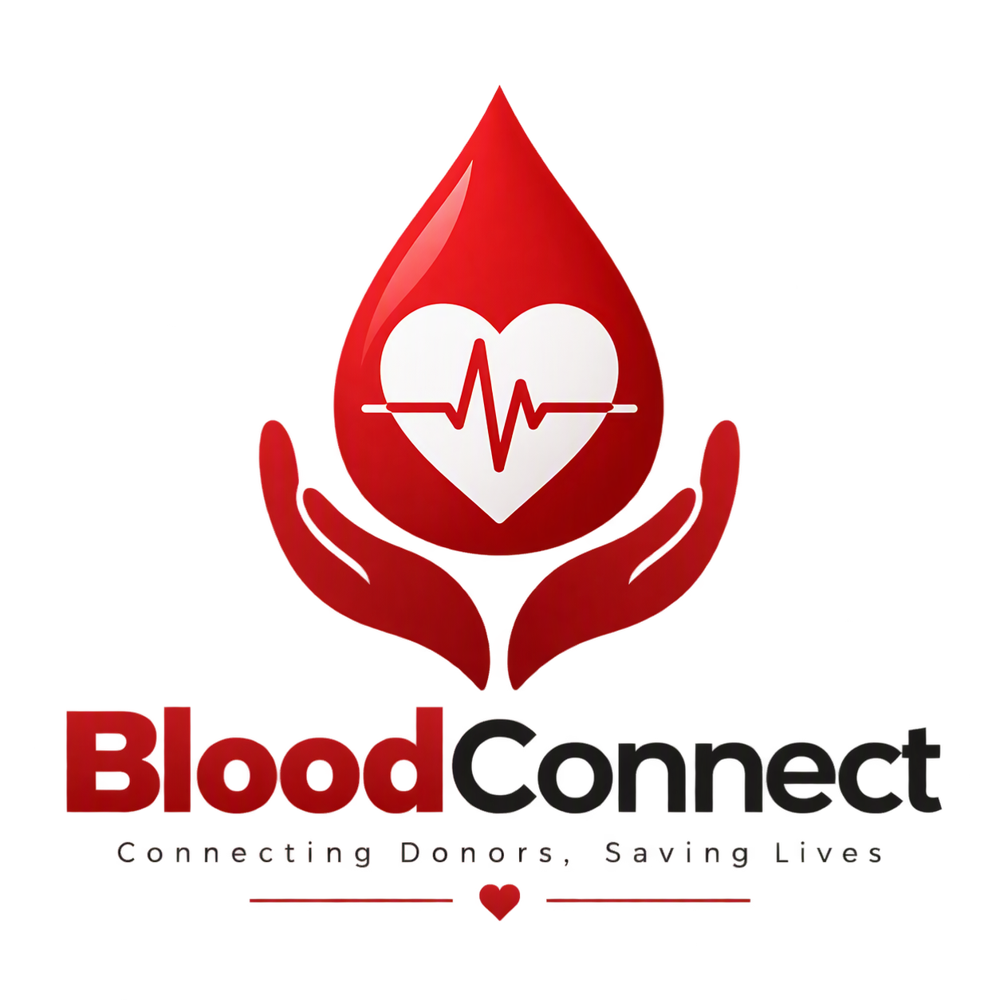
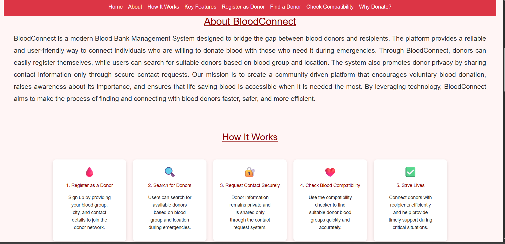
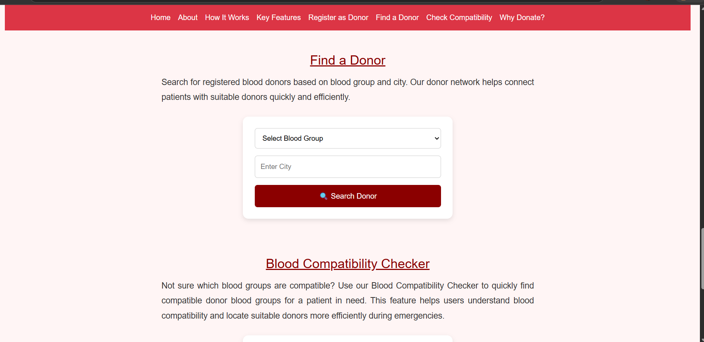
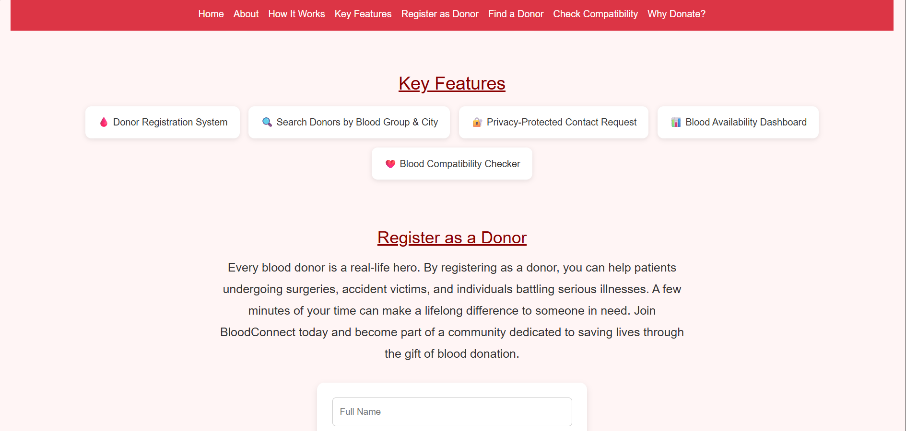
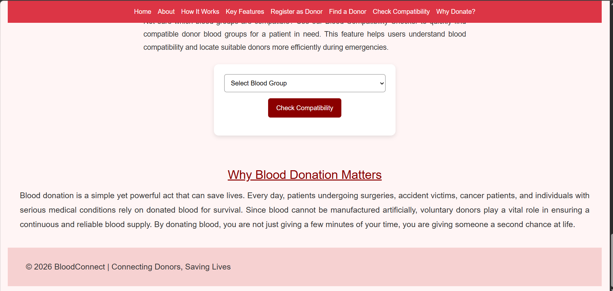

# 🩸 Blood Connect

A responsive Blood Bank Management website developed to connect blood donors and recipients through a simple, accessible, and user\-friendly platform. Blood Connect helps users register as donors, search for suitable donors, check blood availability, understand blood group compatibility, and access blood donation information while maintaining donor privacy.

## 🚀 Features

- Donor Registration System
- Blood Availability Information
- Blood Group Compatibility Guide
- Responsive User Interface
- Secure and Privacy\-Oriented Design
- Blood Donation Awareness Section
- Easy Navigation and Clean Layout

---

## 🛠️ Technologies Used

- HTML5
- CSS3
- JavaScript
- Responsive Web Design

---

## 📸 Project Screenshots

### Header & Navigation Bar

### Logo

### About & Working Section

### Donor Information Section

### Registration Feature

### Footer

---

## 🎯 Project Objectives

- Encourage voluntary blood donation.
- Simplify the process of finding blood donors.
- Improve awareness about blood group compatibility.
- Provide a centralized platform for blood\-related information.
- Create an intuitive and responsive user experience.

---

## 🌟 Future Enhancements

- Live Blood Inventory Management
- User Authentication System
- Location\-Based Donor Search
- Emergency Blood Request Module
- Blood Bank & Hospital Integration
- Email and SMS Notifications

---
